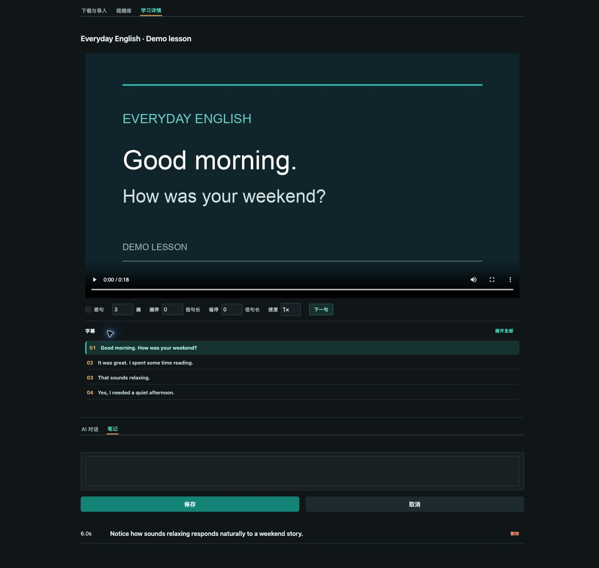
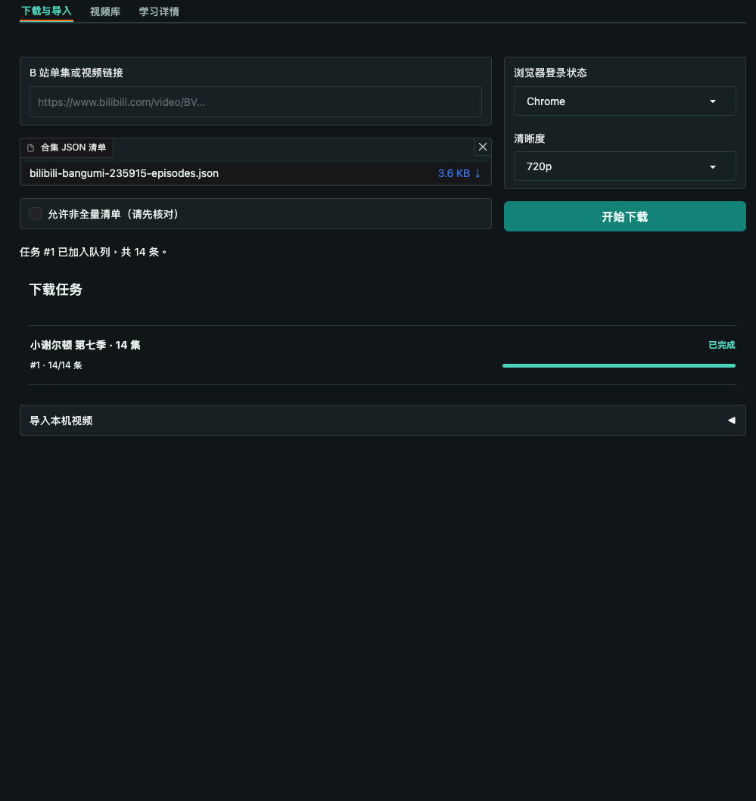

# 视频逐句学习工作台

一个在本机运行的 Gradio 视频学习工具：管理自己的视频，结合带时间戳的字幕逐句循环播放，并记录提问和笔记。



## 能做什么

- 从 B 站单集链接或合集 JSON 清单创建下载任务；可选择读取本机 Chrome / Edge 的登录状态，也可导入本机 MP4、MKV、WebM。
- 视频库按名称分页浏览、打开详情和删除；任务进度自动更新，完成后同步视频库。
- 逐句循环可设置重复次数、每遍后的停顿和整轮后的停顿；正常播放和逐句模式都能调速、跳到下一句。
- 字幕列表随播放高亮并滚动；没有字幕时可调用独立转写服务生成。
- 基于当前句使用提问模板与兼容 Responses API 的 AI 服务对话；笔记自动记录当前播放时间。
- 数据保存在本机 SQLite；页面可按需启用 Gradio 密码。

## 环境要求

- Python 3.12、`ffmpeg` / `ffprobe`、`yt-dlp`；下载 B 站视频时需要网络连接。
- 字幕生成需要另行运行兼容 `POST /api/jobs`、`GET /api/jobs/{id}`、`GET /api/jobs/{id}/segments` 的服务。没有它仍可下载、导入和播放视频。
- AI 对话需要用户自行配置兼容 OpenAI Responses API 或 Chat Completions API 的服务。没有它不影响其他功能。

```bash
git clone https://github.com/benda1989/video-study-workbench.git
cd video-study-workbench
python3.12 -m venv .venv
source .venv/bin/activate
python -m pip install -e .
cp video_study/config.example.py video_study/config.py
python video_study/app.py
```

打开 [http://127.0.0.1:7863](http://127.0.0.1:7863)。如需改端口，设置 `VIDEO_STUDY_PORT` 环境变量。macOS 可用 Homebrew 安装外部命令：`brew install ffmpeg yt-dlp`；其他系统请按各工具的官方说明安装。当前应用只绑定本机 `127.0.0.1`，不直接对公网提供服务。

## 配置

编辑本地 `video_study/config.py`（已加入 `.gitignore`）：

| 配置 | 用途 |
| --- | --- |
| `DATA_PATH` | SQLite 和视频目录；相对路径以 `video_study/` 为基准 |
| `MOSS_URL` | 字幕服务根地址，例如 `http://127.0.0.1:7862` |
| `GRADIO_AUTH_USER` / `GRADIO_AUTH_PASSWORD` | 密码为 `None` 时不启用认证；设置非空密码后启用 |
| `AI_BASE_URL` / `AI_API_KEY` / `AI_MODEL` | AI 服务的 API 根地址、密钥和模型 |
| `AI_API_MODE` | 默认 `responses`；旧接口可设为 `chat_completions` |

不要将填写了密码、API Key 或本机服务地址的 `config.py` 提交到仓库。浏览器登录状态由本机 `yt-dlp --cookies-from-browser` 临时读取，本项目不导出 Cookie 文件；首次使用可能需要系统密钥链授权。请只下载你有权访问、保存和使用的内容。

## 合集导入

1. 在 Tampermonkey 中安装 [`bilibili-episode-export.user.js`](video_study/bilibili-episode-export.user.js)。脚本在 B 站番剧、视频、合集等常见页面尝试导出 JSON 清单。
2. 在“下载与导入”上传 JSON，按需选择 Chrome 或 Edge 登录状态和清晰度，再开始下载。
3. 清单标记为非全量时，先检查内容，再勾选“允许非全量清单”。单个视频也可直接输入链接；当前下载器接受 `www.bilibili.com/video/BV...` 和 `www.bilibili.com/bangumi/play/ep...`，以及视频分 P 参数 `p`。



导出脚本覆盖的页面类型比下载器直接输入链接更广；其他合集应先导出清单，再由下载器逐条处理。会员或付费内容仍受账号实际权限和 B 站规则限制。

## 数据与版权

默认在 `video_study/` 下生成 `library.sqlite3` 和 `videos/`。两者与本地配置均被 Git 忽略。删除视频会同时删除本机媒体及关联字幕、笔记和对话，操作前请自行备份。软件采用 [Apache License 2.0](LICENSE)；此许可证**不**授予第三方视频、音频、字幕、B 站页面或用户内容的再分发权。本项目与哔哩哔哩没有关联。

## 开发验证

```bash
python -m compileall -q video_study
node --check video_study/player.js
```

发布前请检查 `git status --short` 和 `git ls-files`，确认没有视频、数据库、凭证或私人文件。示例截图使用合成内容，见 [`docs/screenshots/`](docs/screenshots/)。
